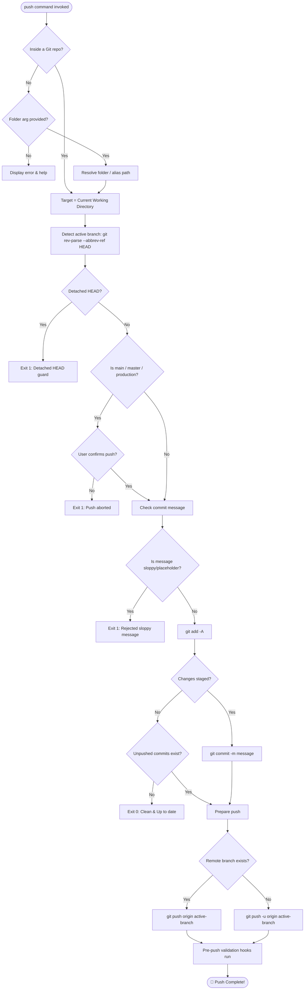

# 🚀 `git-push` / `push` — Opinionated Branch Push CLI

> An opinionated Git utility to enforce clean commit standards, protect production branches, and push directly to active Git branches in both standalone repositories and multi-repository workspaces.

---

## 📖 Table of Contents

- [The Opinionated Philosophy](#the-opinionated-philosophy)
- [How It Works](#how-it-works)
- [Opinionated Guards & Features](#opinionated-guards--features)
  - [1. Protected Branch Guard](#1-protected-branch-guard)
  - [2. Commit Message Hygiene & Conventional Commits](#2-commit-message-hygiene--conventional-commits)
  - [3. Detached HEAD Protection](#3-detached-head-protection)
  - [4. Automatic Upstream Tracking](#4-automatic-upstream-tracking)
  - [5. Pre-Push Quality Gate Trigger](#5-pre-push-quality-gate-trigger)
- [Global Installation](#global-installation)
  - [Method 1: User-Level (~/.local/bin)](#method-1-user-level-localbin)
  - [Method 2: System-Wide (/usr/local/bin)](#method-2-system-wide-usrlocalbin)
  - [Method 3: Native Git Subcommand (`git push-active`)](#method-3-native-git-subcommand-git-push-active)
- [Usage Guide](#usage-guide)
  - [1. Inside Any Git Repository](#1-inside-any-git-repository)
  - [2. From a Multi-Repository Parent Workspace](#2-from-a-multi-repository-parent-workspace)
  - [3. Interactive Prompt Mode](#3-interactive-prompt-mode)
  - [4. Pushing Existing Unpushed Commits](#4-pushing-existing-unpushed-commits)
- [Environment Variables](#environment-variables)
- [Architecture & Flowchart](#architecture--flowchart)
- [Troubleshooting](#troubleshooting)

---

## The Opinionated Philosophy

Git gives developers absolute freedom—including the freedom to push directly to production branches by accident, write meaningless one-word commit messages like `"fix"` or `"wip"`, and push from detached states.

`git-push` is designed with an **opinionated engineering stance**:
- **Protect Production**: Accidental pushes to `main` / `master` / `production` must be challenged.
- **Enforce Commit Quality**: Sloppy commit messages corrupt project history. Conventional commits are encouraged and placeholders are rejected.
- **Zero Configuration**: Active branches are auto-detected dynamically, and new remote branches are automatically configured with upstream tracking (`-u`).

---

## How It Works

1. **Context Resolution**:
   - Inside an existing Git repository? Targets current directory.
   - Inside a multi-repo parent workspace? Resolves the subfolder or alias (e.g. `client` -> `bingwa_client_mobile`).
2. **Active Branch Detection**:
   - Queries `git rev-parse --abbrev-ref HEAD`.
   - Rejects detached HEAD states (`HEAD`) immediately.
3. **Protected Branch Guard**:
   - If the active branch is `main`, `master`, or `production`, prompts the developer for explicit confirmation before proceeding.
4. **Commit Hygiene Check**:
   - Rejects placeholder messages like `"wip"`, `"fix"`, `"update"`, `"temp"`.
   - Recommends Conventional Commits format (`type(scope): description`).
5. **Smart Staging & Commit**:
   - Stages all working tree modifications via `git add -A`.
   - If changes are present, commits with the specified message.
   - If the working tree is clean, pushes pending local commits.
6. **Push with Automatic Upstream Tracking**:
   - Binds upstream tracking (`git push -u origin <branch>`) on the first push of a new branch.
7. **Pre-Push Quality Gate**:
   - Triggers local pre-push validation (analyzer, unit tests, coverage gates) before remote transmission.

---

## Opinionated Guards & Features

### 1. Protected Branch Guard

Direct pushes to production branches bypass peer reviews and risk introducing regressions. When pushing to `main`, `master`, or `production`, `git-push` guards the operation:

```text
⚠️  OPINIONATED GUARD: You are pushing directly to 'main' in my-web-app.
Direct pushes to production branches bypass PR reviews. Proceed anyway? [y/N]: 
```

To bypass in CI/CD automation:
```bash
ALLOW_MAIN_PUSH=1 push "chore: automated release tag"
```

---

### 2. Commit Message Hygiene & Conventional Commits

Meaningful commit logs are vital for changelogs, bisecting bugs, and team readability.

- **Rejects Sloppy Placeholders**:
  Messages like `wip`, `fix`, `update`, `test`, `changes`, `done`, `asdf` are blocked immediately.
- **Recommends Conventional Commits**:
  Validates against the standard `<type>(<scope>): <subject>` format (e.g. `feat(auth): add sso`, `fix(api): correct null handling`, `refactor: extract service`).

To disable commit linting if necessary:
```bash
SKIP_COMMIT_LINT=1 push "my custom commit"
```

---

### 3. Detached HEAD Protection

Pushing from a detached HEAD leads to lost commits on remote servers. `git-push` detects this condition and instructs the developer how to preserve their commits:

```text
❌ OPINIONATED GUARD: Detached HEAD detected in my-app.
Pushing from a detached HEAD leads to lost commits on remote.
Switch to or create a branch first:
  git checkout -b feature-branch-name
```

---

### 4. Automatic Upstream Tracking

No more `fatal: The current branch has no upstream branch`. `git-push` detects whether the branch exists on remote and automatically passes `-u origin <branch>` on the initial push.

---

### 5. Pre-Push Quality Gate Trigger

`git-push` relies on your repository's local Git hooks (`.githooks/pre-push`). Before the bytes are transferred to GitHub/GitLab, your local test suite, static analyzer, and coverage gates execute automatically.

---

## Global Installation

### Method 1: User-Level (`~/.local/bin`)

Recommended for macOS and Linux (no `sudo` required):

```bash
# 1. Create user binary directory
mkdir -p ~/.local/bin

# 2. Copy git-push binary and grant executable permissions
cp bin/git-push ~/.local/bin/git-push
chmod +x ~/.local/bin/git-push

# 3. Create 'push' alias symlink
ln -sf ~/.local/bin/git-push ~/.local/bin/push
```

Ensure `~/.local/bin` is in your `$PATH` (in `~/.zshrc` or `~/.bashrc`):
```bash
export PATH="$HOME/.local/bin:$PATH"
```

---

### Method 2: System-Wide (`/usr/local/bin`)

Available for all users on the machine:

```bash
sudo cp bin/git-push /usr/local/bin/git-push
sudo chmod +x /usr/local/bin/git-push
sudo ln -sf /usr/local/bin/git-push /usr/local/bin/push
```

---

### Method 3: Native Git Subcommand (`git push-active`)

Git discovers any executable named `git-<subcommand>` in your `$PATH`:

```bash
cp bin/git-push ~/.local/bin/git-push-active
chmod +x ~/.local/bin/git-push-active
```

Usage:
```bash
git push-active "feat(auth): implement oauth2 flow"
```

---

## Usage Guide

### 1. Inside Any Git Repository

```bash
cd ~/projects/my-web-app
push "feat(auth): add google sign-in button"
```

**Output:**
```text
====================================================
🚀 Git Push: my-web-app ➜ feature/google-auth
   Commit:   feat(auth): add google sign-in button
   Remote:   origin
====================================================
📝 Staging changes and committing...
[feature/google-auth 4a8e2b1] feat(auth): add google sign-in button
✅ Committed (4a8e2b1): feat(auth): add google sign-in button
⬆️  Pushing to origin/feature/google-auth...
====================================================
🎉 Successfully pushed my-web-app to origin/feature/google-auth!
====================================================
```

---

### 2. From a Multi-Repository Parent Workspace

```bash
cd ~/projects/company-workspace/

push client "fix(ui): repair responsive table overflow"
push partner "feat(orders): add date range filter"
push api "refactor(sql): add user email index"
push portal "fix(routing): prevent hash loss on reload"
```

---

### 3. Interactive Prompt Mode

If invoked without a commit message in an interactive terminal:

```bash
push
# Output:
# 💬 No commit message supplied for [my-web-app (main)].
# Enter commit message: feat(billing): add stripe webhook handler
```

---

### 4. Pushing Existing Unpushed Commits

If you already committed changes via an IDE:

```bash
push "sync work"
# Output:
# ℹ️  Working tree clean, but found 2 unpushed commit(s) on 'dev'.
# ⬆️  Pushing to origin/dev...
# 🎉 Successfully pushed my-web-app to origin/dev!
```

---

## Environment Variables

| Variable | Default | Purpose |
| :--- | :--- | :--- |
| `GIT_PUSH_REMOTE` | `origin` | Target Git remote name. Set to `upstream` or custom remote if desired. |
| `ALLOW_MAIN_PUSH` | `0` | Set to `1` to bypass the interactive confirmation for `main`/`master` pushes. |
| `SKIP_COMMIT_LINT`| `0` | Set to `1` to bypass the Conventional Commits format verification. |
| `NO_COLOR` | `unset` | Disable ANSI terminal color codes (for CI/CD environments). |

---

## Architecture & Flowchart



---

## Troubleshooting

### Q: `Commit message 'wip' is a sloppy commit message`
**Solution**: Provide a descriptive commit message following Conventional Commits format, e.g. `feat(auth): add refresh token endpoint`.

### Q: `Push blocked: Direct push to 'main' prohibited`
**Solution**: Create a feature branch with `git checkout -b feature/my-work` and push to it instead, or set `ALLOW_MAIN_PUSH=1 push "commit message"`.
