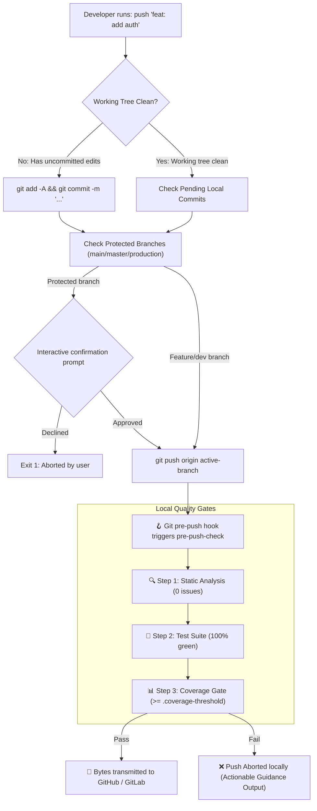

# 🛠️ git-cli-scripts

> A developer workflow toolchain to automate active-branch Git pushes and enforce zero-defect local pre-push quality gates (static analysis, unit tests, and production code coverage) with **user-defined thresholds**.

[](./license.md)
[](./contribution.md)
[](#-the-quality-manifest)
[](#-how-to-set-or-change-your-coverage-threshold)
[](https://www.gnu.org/software/bash/)
[](https://flutter.dev)
[](https://nodejs.org)
[](https://python.org)
[](https://go.dev)

---

## 📖 Table of Contents

- [The Quality Manifest](#-the-quality-manifest)
- [Architecture & Workflow](#-architecture--workflow)
- [How to Set or Change Your Coverage Threshold](#-how-to-set-or-change-your-coverage-threshold)
- [The Toolchain](#-the-toolchain)
- [Repository Structure](#-repository-structure)
- [1-Minute Quickstart](#-1-minute-quickstart)
  - [1. Install CLI Tools Globally](#1-install-cli-tools-globally-on-your-machine)
  - [2. Configure Quality Gates for Any Repository](#2-configure-quality-gates-for-any-repository)
- [In-Depth Documentation](#-in-depth-guides)
- [Contributing](#-contributing)
- [License](#-license)

---

## 🏛️ The Quality Manifest

Most engineering teams rely on cloud CI/CD pipelines to catch bugs. But cloud runners are slow, costly, and provide feedback 10 minutes too late.

`git-cli-scripts` is built on a clear principle: **remote CI should be a formal stamp of approval, never a debugging tool.** Broken code, flaky tests, and untested features must never leave a developer's laptop.

### User-Defined Quality Standards

> **We do not tell you what your threshold must be. We strictly enforce whatever threshold you choose.**

Many legacy tools impose arbitrary fixed amounts (like mandating `>= 70%` or `>= 80%`). That doesn't work across real-world teams:
- A brand-new security microservice might target **`95%`**.
- A mature mobile app might maintain **`80%`**.
- An existing legacy codebase might start at **`65%`** and increase incrementally.

Our toolchain empowers you to **enter your own threshold**. Once you set it, our gates strictly enforce your chosen target on every push, giving you and your team total ownership of your quality bar.

### 4 Core Quality Gates

1. 🔍 **Zero Broken Windows (Zero-Tolerance Lints)**:
   Compiler and linter warnings are treated as hard failures. If `flutter analyze` or `npm run lint` reports issues, the push is terminated immediately.
2. 🧪 **100% Green Test Suite**:
   Every unit, widget, and integration test must pass. A single failing test blocks the push.
3. 📊 **Strict User-Defined Coverage Gates (No Imposed Fixed Amounts)**:
   You enter your repository's target threshold (e.g. 75%, 80%, 85%, 90%). Pre-push hooks strictly block any push where coverage drops below your specified threshold.
4. 🛡️ **Branch Hygiene & Protected Branch Guards**:
   Accidental pushes to `main`, `master`, or `production` are guarded with interactive confirmation. Pushes from detached HEAD states are completely prohibited.

---

## 🔄 Architecture & Workflow



---

## 🎯 How to Set or Change Your Coverage Threshold

You have full ownership of your coverage target. Here is how to set it, inspect it, or change it anytime:

| Method | Command | Where It Is Used |
| :--- | :--- | :--- |
| **1. Hook Setup** | `./install.sh --hooks 85` | When initializing hooks for your repo |
| **2. CLI Helper** | `pre-push-check --set-threshold 85` | Quick CLI command from anywhere in repo |
| **3. Config File** | `echo "85" > .coverage-threshold` | Git-tracked file shared with whole team |
| **4. Single-Push Override** | `MIN_COVERAGE=85 git push` | For temporary testing or CI runs |
| **5. Inspect Current Target**| `pre-push-check --info` | View active threshold & where it was set |

### Step-by-Step Examples

#### Setting Your Target During Installation
When setting up hooks in any repository, you can pass your desired percentage directly:
```bash
./install.sh --hooks 85
```
If you omit the percentage (`./install.sh --hooks`), the installer will prompt you interactively:
```text
⚙️  Configure Coverage Quality Gate:
   We do not mandate a fixed percentage. Enter your repository's desired target:
   Minimum coverage percentage (e.g. 70, 75, 80, 85, 90) [Default: 80]: 85
🎯 Saved 85% in .coverage-threshold
```

#### Changing Your Target Later
As your test suite matures, you can increase your threshold at any time:
```bash
# Raise threshold from 80% to 85%
pre-push-check --set-threshold 85

# Commit to share with your team
git add .coverage-threshold
git commit -m "chore: elevate test coverage threshold to 85%"
git push
```

---

## 🧰 The Toolchain

| Tool | Purpose | Primary Command |
| :--- | :--- | :--- |
| **`git-push`** / **`push`** | Branch-aware push. Validates conventional commits, protects production branches, and pushes active branches with upstream tracking. | `push "feat: my commit"` |
| **`pre-push-check`** | Pre-push quality gatekeeper. Auto-detects Flutter, Node/TS, Python, or Go, enforcing zero-defect analysis, tests, and user-defined coverage. | `git push` (hook) or `pre-push-check` |

---

## 📁 Repository Structure

```text
git-cli-scripts/
├── bin/
│   ├── git-push             # Smart commit & push CLI with branch guards & conventional commit checks
│   └── pre-push-check       # Quality validator (analyzer, tests, user-defined coverage)
├── hooks/
│   ├── pre-push             # Git pre-push hook template (invokes pre-push-check)
│   └── post-merge           # Git post-merge hook (keeps permissions intact on git pull)
├── install.sh               # Single-command installer for global tools or repo hooks
├── readme.md                # Main overview and quickstart (this file)
├── git_push.md              # In-depth guide for 'git-push' and 'push'
├── pre_push_hooks.md        # In-depth guide for automated pre-push validation gates
├── contribution.md          # Open-source contribution guidelines
└── license.md               # MIT License
```

---

## ⚡ 1-Minute Quickstart

### 1. Install CLI Tools Globally on Your Machine

```bash
# Clone the repository
git clone https://github.com/quiesscent/git-cli-scripts.git ~/git-cli-scripts

# Run installer (installs to ~/.local/bin)
cd ~/git-cli-scripts
./install.sh
```

Ensure `~/.local/bin` is in your `$PATH` (in `~/.zshrc` or `~/.bashrc`):
```bash
export PATH="$HOME/.local/bin:$PATH"
```

Now you can use `push` from **any terminal session**:
```bash
# Inside any repository:
push "feat(auth): add refresh token support"

# From a multi-repo parent workspace:
push client "fix(ui): repair mobile layout overflow"
```

---

### 2. Configure Quality Gates for Any Repository

Want your repository to enforce strict quality gates automatically for everyone on your team?

Navigate to your project root and run:
```bash
cd /path/to/your/repository

# Install hooks and set your team's threshold (e.g. 85%):
~/git-cli-scripts/install.sh --hooks 85
```

This installs version-controlled hooks into `.githooks/`, creates `.coverage-threshold`, and configures Git:
```bash
git config core.hooksPath .githooks
```

Commit `.githooks/` and `.coverage-threshold` to your repository:
```bash
git add .githooks .coverage-threshold
git commit -m "chore(quality): enforce automated pre-push gates with 85% coverage target"
git push
```

Now, **every team member who pulls or clones your repository** will automatically run static analysis, tests, and coverage validation against your team's configured target before every push!

---

## 📚 In-Depth Guides

- **[`git_push.md`](./git_push.md)**:
  - Branch detection and detached HEAD guards.
  - Protected production branch prompts (`main`/`master`).
  - Conventional Commits hygiene.
  - Standalone repo vs. multi-repo parent workspace usage.
- **[`pre_push_hooks.md`](./pre_push_hooks.md)**:
  - Deep-dive into automated pre-push quality gates.
  - Comprehensive guide on setting, modifying, and evolving coverage thresholds.
  - Language-specific configurations (Flutter, Node/TS, Python, Go).
  - Version-controlling hooks via `.githooks` across distributed teams.
  - Emergency bypass flags (`--no-verify`).

---

## 🤝 Contributing

Contributions are welcomed and encouraged! Check out our [contribution guidelines](./contribution.md) for details on code style, testing in isolated environments, and submitting pull requests.

---

## 📄 License

Distributed under the [MIT License](./license.md). You are free to adopt, modify, distribute, and open-source this suite for personal or corporate development.


